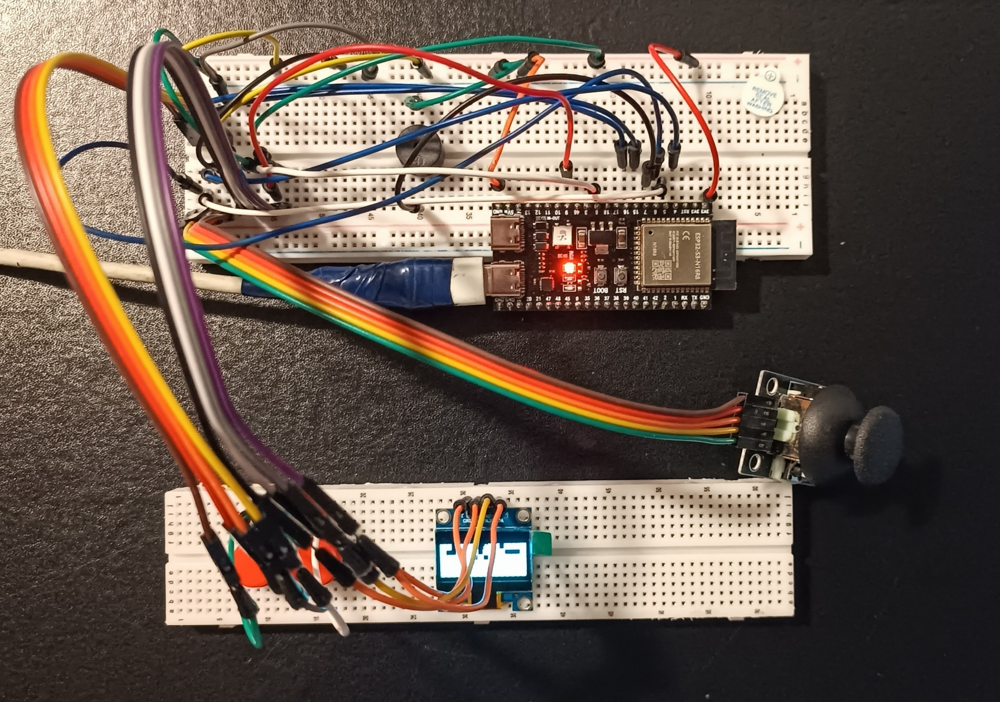
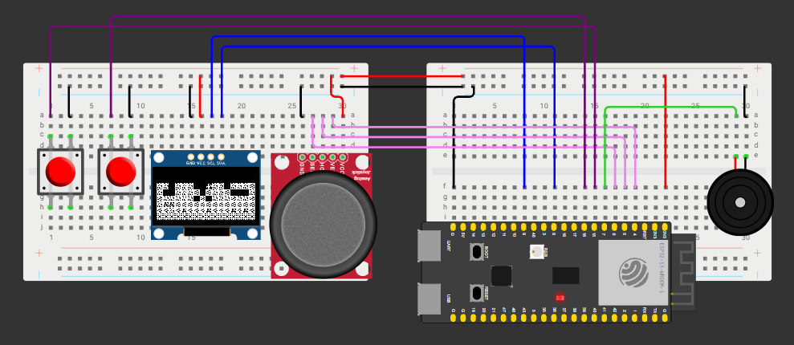

# ⛏️ Pocket Miner ESP32

**Pocket Miner ESP32** — це саморобна портативна міні-консоль на базі мікроконтролера ESP32-S3. Основний застосунок проєкту — 2D-аркада, натхненна механіками Terraria, де гравець може досліджувати процедурно згенерований світ, взаємодіяти з блоками (копати) та переміщуватися платформером. 

Уся графіка оптимізована для 1-бітного монохромного OLED-дисплея, а спрайти (8x8 пікселів) створені у кастомному редакторі піксель-арту **POD2d**.

## ✨ Можливості
*   **Процедурна генерація світу:** Карта генерується випадковим чином при кожному запуску (земля, камінь, руда, бедрок).
*   **Фізика та колізії:** Реалізована гравітація, стрибки та прораховування зіткнень із блоками по всіх осях.
*   **Взаємодія з оточенням:** Можливість руйнувати блоки в чотирьох напрямках за допомогою аналогового джойстика та кнопки дії.
*   **Апаратний звук:** Звукові 8-бітні ефекти ударів кирки через п'єзодинамік.
*   **Оптимізація пам'яті:** Спрайти зберігаються у PROGMEM (Flash-пам'яті) у форматі масивів байтів.

## 📂 Структура репозиторію

*   `/firmware` — вихідний код C++ (`.ino` файли) для прошивки ESP32.
*   `/hardware` — схема підключення (`diagram.json` для Wokwi) та Bill of Materials (BOM).
*   `/assets` — медіафайли, скріншоти та фотографії готового пристрою.

## ⚙️ Апаратна частина (Hardware)

Проєкт не вимагає спеціальної друкованої плати (PCB) і може бути зібраний на звичайній макетній платі (Breadboard). 

**Основні компоненти:**
*   **Мікроконтролер:** ESP32-S3 DevKitC (ESP32-S3-WROOM-1-N16R8)
*   **Екран:** OLED 0.96" (128x64), I2C, SSD1306
*   **Управління:** Аналоговий джойстик (XY) та 2 тактові кнопки
*   **Звук:** Пасивний п'єзодинамік (Buzzer)

### Схема підключення (Wiring)

| Компонент | Пін компонента | Пін ESP32-S3 | Примітка |
| :--- | :--- | :--- | :--- |
| **OLED Дисплей** | SDA | GPIO 8 | Шина I2C |
| | SCL | GPIO 9 | Шина I2C |
| **Джойстик** | VRX | GPIO 4 | Читання через АЦП |
| | VRY | GPIO 5 | Читання через АЦП |
| **Кнопка "Стрибок"**| Сигнал | GPIO 15 | `INPUT_PULLUP` (замикання на GND) |
| **Кнопка "Дія"** | Сигнал | GPIO 16 | `INPUT_PULLUP` (замикання на GND) |
| **П'єзодинамік** | Сигнал | GPIO 7 | ШІМ (`tone()`) |

> [!NOTE]
> Усі компоненти живляться від лінії **3.3V** ESP32-S3. Не підключайте екран чи джойстик до 5V, щоб не пошкодити логічні рівні мікроконтролера.

## 🚀 Встановлення та прошивка

Для компіляції та завантаження коду на мікроконтролер використовується Arduino IDE (або PlatformIO).

### 1. Залежності (Libraries)
Переконайтеся, що через Library Manager встановлені наступні бібліотеки:
*   `Adafruit GFX Library`
*   `Adafruit SSD1306`

### 2. Налаштування плати (Arduino IDE)
Оскільки використовується плата версії **N16R8**, перед прошивкою необхідно встановити правильні параметри у меню `Tools` (Інструменти):
*   **Board:** ESP32S3 Dev Module
*   **Flash Size:** 16MB (128Mb)
*   **PSRAM:** OPI PSRAM
*   **USB CDC On Boot:** Enabled

### 3. Запуск
Відкрийте файл `firmware/pocket_miner/pocket_miner.ino`, підключіть плату через порт `USB` (не UART) та натисніть **Upload**.

## 🎮 Керування
*   **Джойстик Вліво/Вправо:** Рух персонажа.
*   **Ліва кнопка:** Стрибок.
*   **Права кнопка (затиснути) + Джойстик:** Копати у вибраному напрямку.

## 👤 Автор

**Артем Наврощук** 
* GitHub: [@ilertwo](https://github.com/ilertwo)
* LinkedIn: [Artem Navroshchuk](https://www.linkedin.com/in/artem-navroshchuk)

## 📄 Ліцензія
Цей проєкт розповсюджується під ліцензією [MIT](LICENSE). Ви можете вільно використовувати, змінювати та розповсюджувати цей код.